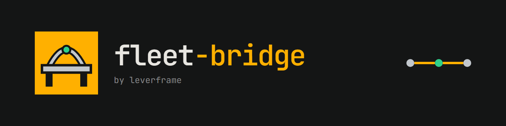
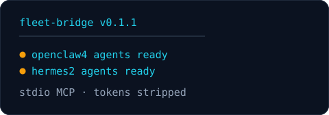
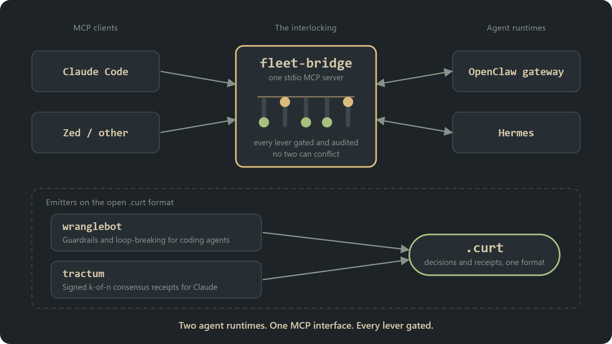

<p align="center">
  
</p>

<p align="center">Bridge your OpenClaw gateway agents and Hermes agents to any MCP client.</p>

<p align="center">
<a href="https://www.npmjs.com/package/fleet-bridge"></a>
<a href="https://github.com/leverframe/fleet-bridge/actions/workflows/ci.yml"></a>
<a href="LICENSE"></a>
</p>

<p align="center"><a href="docs/QUICKSTART.md"><strong>Quickstart</strong></a> · <a href="https://docs.leverframe.dev/fleet-bridge/">Documentation</a></p>

```bash
npx fleet-bridge
```

---

Your agents already exist. They live on an OpenClaw gateway, or on a box
somewhere running Hermes. The problem is getting at them: every client wants a
different integration, every runtime speaks a different protocol.

fleet-bridge says no to all of that. It's one stdio MCP server. Point Zed,
Claude Code, or any MCP client at it, and every agent on your fleet shows up
as a tool you call by name.

<p align="center">
  
</p>

> **Tokens never leave the box running the bridge.** Every tool output strips
> agent tokens and SSH details before the client sees them.

## How it fits together

<p align="center">
  
</p>

Three properties worth knowing:

- **Stateless.** The bridge reads its rosters once at startup and holds
  nothing. Multi-turn conversation state lives in the agent gateways, where it
  already was.
- **File-driven.** Two JSON files define your fleet. Edit, restart, done.
- **Two runtimes, one shape.** OpenClaw agents over HTTP, Hermes agents over
  SSH — both flatten into the same six-tool surface.

## Tools

| Tool | What it does |
|---|---|
| `list_agents` | List OpenClaw agents — `{name, role, tier, host, port}`, token stripped |
| `agent_health` | Hit the agent gateway's `/health`, return its JSON |
| `start_session` | Mint a `session_key` for multi-turn conversation (gateway-side state) |
| `invoke_agent` | Prompt an OpenClaw agent; streams, supports `session_key` + `timeout_ms` |
| `list_hermes_agents` | List Hermes agents — `{name, role, model, host}`, SSH details stripped |
| `invoke_hermes` | One-shot prompt to a Hermes agent; always stateless |

Both invoke tools emit `notifications/progress` when the client passes
`_meta.progressToken`; without it you get the same final result, just quieter.

## Point it at your fleet

The bridge reads two roster files at startup — both `chmod 600`, both
gitignored, because they hold tokens and SSH details:

- `agents.json` — OpenClaw: `{"agents": [{"name", "role", "tier", "model?", "port", "host", "token"}]}`
- `hermes-agents.json` — Hermes: `{"agents": [{"name", "role", "model?", "host", "ssh_user", "binary"}]}`

Missing file, empty roster — the bridge starts anyway. Full field reference in
[`docs/CONFIG.md`](docs/CONFIG.md).

On the box running your OpenClaw agents, build the roster from the live
gateway configs:

```bash
bash scripts/build-agents.json.sh /tmp/agents.json
```

It scans `$HOME/.openclaw-*/openclaw.json` for ports and tokens. Set
`FLEET_HOST` if agents aren't on `127.0.0.1`. Add or rotate an agent: change
the OpenClaw config, re-run, redeploy, restart your client.

| Variable | Default | Purpose |
|---|---|---|
| `FLEET_BRIDGE_AGENTS` | `<repoRoot>/agents.json` | Path to the OpenClaw roster |
| `FLEET_BRIDGE_HERMES` | `<repoRoot>/hermes-agents.json` | Path to the Hermes roster |
| `FLEET_BRIDGE_HEALTH_TIMEOUT_MS` | `5000` | Abort timeout for `agent_health` |
| `FLEET_BRIDGE_INVOKE_TIMEOUT_MS` | `60000` | Default invoke timeout when the call omits `timeout_ms` |

## Prove it works

No MCP client needed. Build, swap in an agent name from your roster:

```bash
npm install && npm run build

printf '%s\n' \
  '{"jsonrpc":"2.0","id":1,"method":"initialize","params":{"protocolVersion":"2024-11-05","capabilities":{},"clientInfo":{"name":"smoke","version":"0"}}}' \
  '{"jsonrpc":"2.0","method":"notifications/initialized"}' \
  '{"jsonrpc":"2.0","id":2,"method":"tools/call","params":{"name":"invoke_agent","arguments":{"name":"my-agent","prompt":"reply with exactly: pong"}}}' \
  | node dist/index.js
```

Expect `pong` from a real agent. Add `"_meta":{"progressToken":"t1"}` to the
`tools/call` params to watch streaming progress notifications roll in.
Beyond that: agent-side faults usually show in `journalctl` on the agent host
(OpenClaw runs as systemd units).

## Security

Agent traffic is plain `http://` by design. Run the bridge where the agents
are — loopback, LAN, or a private overlay. Don't expose agent gateways to the
public internet; there is no TLS option in v0.1. Keep roster files `chmod 600`
and out of any synced tree you don't control.

## License

[MIT](LICENSE)
