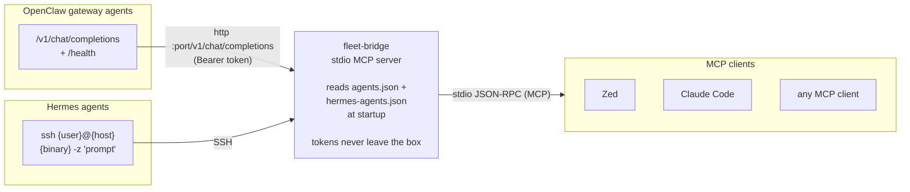

<p align="center">
  
</p>

# fleet-bridge

Bridge your OpenClaw gateway agents and Hermes agents to any MCP client.

[](https://www.npmjs.com/package/fleet-bridge)
[](https://github.com/leverframe/fleet-bridge/actions/workflows/ci.yml)
[](LICENSE)

**Quickstart**

```bash
npx fleet-bridge
```

</div>

---

fleet-bridge is a stdio MCP server that gives one tool surface across two agent
runtimes: OpenClaw gateway agents over HTTP (`/v1/chat/completions`) and Hermes
agents over SSH (`hermes -z`). Any MCP client — Zed, Claude Code, or anything
else that speaks MCP — sees a single list of tools and invokes any agent by
name. Conversation state for multi-turn sessions lives server-side in the agent
gateways; the bridge itself is stateless and reads its rosters once at startup.
Tokens never leave the box running the bridge — every tool output strips them.

**v0.1.1** · MIT licensed · [Full documentation](https://docs.leverframe.dev/fleet-bridge/)

## Architecture



## Tools

| Tool | What it does |
|---|---|
| `list_agents` | List OpenClaw agents with `{name, role, tier, host, port}` (token stripped) |
| `agent_health` | Call the agent gateway's `/health` and return its JSON |
| `start_session` | Generate a `session_key` for multi-turn conversation (state is persisted by the gateway, not the bridge) |
| `invoke_agent` | Send a prompt to an OpenClaw agent; streams internally, supports `session_key` and `timeout_ms` |
| `list_hermes_agents` | List Hermes agents with `{name, role, model, host}` (SSH user and binary path stripped) |
| `invoke_hermes` | One-shot prompt to a Hermes agent via SSH; always stateless |

`invoke_agent` and `invoke_hermes` emit `notifications/progress` when the
client passes `_meta.progressToken`; clients without it get the same final
result with no intermediate updates.

## Configuration

The bridge is file-driven at startup. It reads two roster files (both
`chmod 600`, **gitignored** — they contain tokens and SSH details):

- `agents.json` — OpenClaw agents: `{"agents": [{"name", "role", "tier", "model?", "port", "host", "token"}]}`
- `hermes-agents.json` — Hermes agents: `{"agents": [{"name", "role", "model?", "host", "ssh_user", "binary"}]}`

Both fall back to an empty roster if missing; edit a roster and restart the
bridge. See [`docs/CONFIG.md`](docs/CONFIG.md) for the full field reference.

Environment variables:

| Variable | Default | Purpose |
|---|---|---|
| `FLEET_BRIDGE_AGENTS` | `<repoRoot>/agents.json` | Path to the OpenClaw roster |
| `FLEET_BRIDGE_HERMES` | `<repoRoot>/hermes-agents.json` | Path to the Hermes roster |
| `FLEET_BRIDGE_HEALTH_TIMEOUT_MS` | 5000 | Abort timeout for `agent_health` HTTP calls |
| `FLEET_BRIDGE_INVOKE_TIMEOUT_MS` | 60000 | Default timeout for `invoke_agent` / `invoke_hermes` when the call omits `timeout_ms` |

Build an OpenClaw roster from the live gateway configs on the box running your
agents (requires `jq`):

```bash
bash scripts/build-agents.json.sh /tmp/agents.json
```

The script scans `$HOME/.openclaw-*/openclaw.json` and extracts each agent's
port and token. Set `FLEET_HOST` if the agents are reachable on a host other
than the default (`127.0.0.1`). Copy the output to `agents.json` or point
`FLEET_BRIDGE_AGENTS` at it. To add or rotate an agent: change its OpenClaw
config, re-run the script, redeploy the roster, restart your MCP client.

## Quickstart

[`docs/QUICKSTART.md`](docs/QUICKSTART.md) walks through install, roster
setup, and wiring the bridge into an MCP client.

Smoke test without an MCP client — build first (`npm install && npm run
build`), substitute an agent name from your roster:

```bash
printf '%s\n' \
  '{"jsonrpc":"2.0","id":1,"method":"initialize","params":{"protocolVersion":"2024-11-05","capabilities":{},"clientInfo":{"name":"smoke","version":"0"}}}' \
  '{"jsonrpc":"2.0","method":"notifications/initialized"}' \
  '{"jsonrpc":"2.0","id":2,"method":"tools/call","params":{"name":"invoke_agent","arguments":{"name":"my-agent","prompt":"reply with exactly: pong"}}}' \
  | node dist/index.js
```

Streaming variant (progress notifications):

```bash
printf '%s\n' \
  '{"jsonrpc":"2.0","id":1,"method":"initialize","params":{"protocolVersion":"2024-11-05","capabilities":{},"clientInfo":{"name":"smoke","version":"0"}}}' \
  '{"jsonrpc":"2.0","method":"notifications/initialized"}' \
  '{"jsonrpc":"2.0","id":2,"method":"tools/call","params":{"name":"invoke_agent","arguments":{"name":"my-agent","prompt":"count to 10"},"_meta":{"progressToken":"t1"}}}' \
  | node dist/index.js
```

Expect at least one `notifications/progress` message before the final `tools/call`
result. Bridge-side debugging beyond this: run the smoke test above; agent-side
faults usually show in `journalctl` on the agent host (OpenClaw runs as systemd
units).

## Security

- Agent traffic is plain `http://` by design. Run the bridge on a network you
  trust (loopback, LAN, or a private overlay) — do not expose agent gateways to
  the public internet. No TLS option in v0.1.
- Tokens (`agents.json`) and SSH details (`ssh_user`, `binary` in
  `hermes-agents.json`) are stripped from all tool outputs and never leave the
  box running the bridge.
- Roster files are gitignored; keep them `chmod 600` and out of any synced or
  backed-up tree you don't control.

## License

[MIT](LICENSE)
